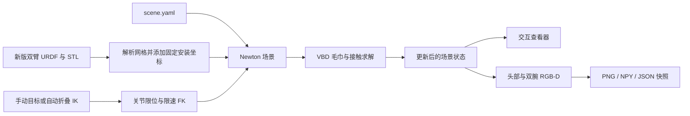

# ENCOS 双臂叠毛巾仿真完整指南

本文汇总本项目的模型、Conda 环境、RViz 预览、Newton 布料仿真、自动折叠、三路相机、参数、验证和排错。
文档对应 2026-11-03 的实现；默认值以 [scene.yaml](scene.yaml)、行为以 [towel_scene.py](towel_scene.py) 为准。
除特别注明，命令均在项目根目录执行：

```bash
cd /home/yanziyu/projects/HW_arm/towel_task
```

## 目录

1. [当前能力与系统结构](#当前能力与系统结构)
2. [文件与模型资产](#文件与模型资产)
3. [Conda 环境配置](#conda-环境配置)
4. [启动与界面操作](#启动与界面操作)
5. [机器人与毛巾建模](#机器人与毛巾建模)
6. [自动抓角与一次对折](#自动抓角与一次对折)
7. [VR 遥操作](#vr-遥操作)
8. [头部与腕部相机](#头部与腕部相机)
9. [图像与深度导出](#图像与深度导出)
10. [参数配置与调整](#参数配置与调整)
11. [代码结构与运行流程](#代码结构与运行流程)
12. [验证与验收](#验证与验收)
13. [常见问题](#常见问题)
14. [当前限制与后续接口](#当前限制与后续接口)

## 当前能力与系统结构

当前场景使用 `dual_arm/urdf/dual_arm.urdf`，包含双臂机器人、模型自带的两个旋转式夹爪、
桌面、30 × 30 cm 毛巾，以及头部、左腕、右腕三路相机。
支持手动关节控制、VR 手柄遥操作，以及自动抓住两个近端角完成**一次双臂对折**，目标尺寸约为 15 × 30 cm。
夹爪外观与碰撞来自新版 STL，当前不包含左臂单独进行第二次折叠的流程。

| 入口 | 用途 | 环境 | 物理与相机 |
|---|---|---|---|
| `make visualize` | RViz 查看模型、TF、关节和夹爪 | 系统 ROS 2 + `.venv-robot` | 不计算毛巾物理，不包含 Newton 相机 |
| `make sim-demo` | 官方 Franka 布料示例，用于验证安装 | Conda `towel-newton` | 官方示例，不是本项目的双臂 |
| `make sim` | 本项目双臂、毛巾、手动控制与三路相机 | Conda `towel-newton` | Newton VBD + RGB-D |
| `make sim-fold` | 本项目自动抓角与一次对折 | Conda `towel-newton` | 同上，启动时自动执行折叠 |
| `make sim-vr` | 用现有 VR 手柄控制仿真双臂和夹爪 | Newton Conda + 现有 VR Python 子进程 | 桌面观察，无头显图像传输 |

Newton 仿真不需要连接真机、运行 ROS 节点或启动电机驱动。
机械臂采用限速运动学控制，毛巾采用 VBD 物理求解；抓取成功后用节点绑定辅助保持抓持。
相机用于观测，目前不参与抓角决策。



## 文件与模型资产

| 文件或目录 | 作用 |
|---|---|
| [towel_scene.py](towel_scene.py) | 模型加载、VBD、运动学、自动折叠、相机、UI 与主循环 |
| [scene.yaml](scene.yaml) | 场景与算法参数 |
| [dual_arm.urdf](../dual_arm/urdf/dual_arm.urdf) | 新版双臂、旋转夹爪、相机外壳、碰撞与惯性 |
| [meshes](../dual_arm/meshes) | 新版模型引用的全部 STL 网格 |
| [robot_model.py](robot_model.py) | Newton 与离线 RViz 共用的模型加载、安装高度与抓取点定义 |
| [model_viewer.launch.py](../ros2_ws/src/towel_bringup/launch/model_viewer.launch.py) | 不连接硬件的 ROS 模型预览 |
| [model_viewer.rviz](../ros2_ws/src/towel_bringup/rviz/model_viewer.rviz) | RViz 预览配置 |
| [towel-newton.yml](../environments/towel-newton.yml) | Conda 基础环境 |
| [newton-requirements.txt](../environments/newton-requirements.txt) | 固定 Newton 和 Warp 版本 |
| [check_newton.py](../scripts/check_newton.py) | 导入与 CUDA kernel 检查 |
| [test_newton_scene.py](../tests/test_newton_scene.py) | 模型、物理、折叠和相机回归测试 |
| [vr_input.py](vr_input.py) | 复用 WebXR/Vuer 手柄输入，通过本机 UDP 发送状态，不导入 ROS |
| [vr_control.py](vr_control.py) | 输入校验、扳机门控、增量映射、IK、独立抓持及失联处理 |
| [pose_mapping.py](../teleop/VR_controller/pose_mapping.py) | 真机与仿真共用的坐标转换函数 |
| [test_newton_vr.py](../tests/test_newton_vr.py) | VR 映射、通信、运动和抓取测试 |
| [Makefile](../Makefile) | 所有启动命令 |
| `outputs/simulation/` | 建议的截图和相机快照输出目录，由命令按需创建 |

新版 URDF 提供每臂 7 个旋转关节和每侧 1 个夹指旋转关节，共 16 个活动关节。
`make sim`、`make sim-fold`、`make sim-vr` 和 `make visualize` 均加载同一新版模型，
不再追加 `simple_grippers.xml`。加载器解析 `package://dual_arm/...` 网格路径，
并在内存中添加高度为 1 m 的固定世界安装关节；不会改写源 URDF。
相机外壳使用 URDF 自带网格，不再生成额外方盒外壳。RGB-D 观测使用场景中的虚拟相机外参。
真机控制、真机反馈 RViz 和部署程序仍使用各自原有控制模型；官方 `sim-demo` 是独立安装检查示例。

## Conda 环境配置

### 运行条件

当前已验证的是 Ubuntu 24.04 x86_64、NVIDIA RTX 5080 Laptop GPU（约 16 GB 显存）与驱动 595.99.02。
这是已有验证记录，不是最低硬件要求。项目默认使用 `cuda:0`；交互窗口和 OpenGL 离屏截图还需要可用的图形环境。

| 组件 | 项目配置 |
|---|---|
| Conda 环境 | `towel-newton` |
| Python | 3.12，本机验证版本 3.12.16 |
| Newton | `newton[examples]==1.7.0` |
| Warp | `warp-lang==1.18.0` |
| 其他依赖 | 由上述安装依赖提供，包括 NumPy、PyYAML、Pillow、USD 和查看器依赖 |

仿真独立于机器人控制环境和策略训练环境，不需要在该环境安装 ROS 或 PyTorch。
本机安装流程使用 Warp wheel 提供的运行组件，没有另外安装系统 CUDA Toolkit。

### 首次安装

```bash
nvidia-smi
conda --version
conda env create -f environments/towel-newton.yml
conda activate towel-newton
python -I -m pip install -r environments/newton-requirements.txt
python -I -m pip check
make sim-check
```

环境已存在时，跳过 `conda env create`。创建环境和安装依赖是两个步骤，单独创建 YAML 环境不会安装 Newton。
`make sim-check` 会检查 Newton/USD 导入，并编译、执行一个 Warp CUDA kernel 后核对结果。
首次运行存在内核编译开销，后续会复用缓存。

所有 `sim*` 命令使用 `conda run --no-capture-output -n towel-newton python -I`，
因此日常启动不必先手动激活环境。`-I` 隔离外部 `PYTHONPATH` 和用户 Python 包。
自定义环境名时可使用 `make sim SIM_ENV=你的环境名`，其他 `sim*` 目标同样支持。

### 官方示例验证（可选）

```bash
make sim-demo ARGS="--viewer null --test"
make sim-demo
```

官方示例使用 Franka 和衣物，首次可能下载模型；无窗口测试默认运行 3850 帧后退出。
它用于排查安装链路，与本项目 30 cm 毛巾的双臂任务独立。
已有环境安装记录见 [NEWTON_SETUP.md](../environments/NEWTON_SETUP.md)。

## 启动与界面操作

### 日常使用

```bash
# 手动查看与操作，同时显示三路相机
make sim

# 自动抓角并完成一次对折，同时显示三路相机
make sim-fold
```

交互窗口在折叠完成后继续保留，关闭窗口即可退出。`make sim` 不会自动折叠，可点击 `Reset + fold` 开始。

| 控件 | 行为 |
|---|---|
| `Left arm` / `Right arm` | 展开每臂七个关节滑块，单位弧度，目标值受 URDF 限位约束 |
| `Left opening (%)` / `Right opening (%)` | 0–100% 旋转夹爪开口，0 为闭合，100 为 URDF 角度极限 |
| `Reset + fold` | 重置机器人、毛巾和时间，然后开始一次自动对折 |
| `Stop` | 停止自动流程，保持实际关节位置，并释放绑定的毛巾节点 |
| `Home` | 停止自动流程并释放抓持，限速返回初始关节目标；不重置毛巾 |
| `Reset scene` / 查看器 `Reset` | 恢复初始机器人、毛巾、仿真时间及折叠状态 |
| `Pause` / `Step` | 暂停仿真或单步推进 |
| `Pause Rendering` | 控制渲染；需要暂停物理时使用 `Pause` |
| `Logged Images` | 选择或重新显示三路相机图像窗口 |

手动改变关节或开口会中止正在执行的自动折叠并释放抓持。查看器原有视角导航、布料拖拽和可视化开关仍可使用。
主场景视角与传感器相机独立，拖动主视角不会改变三路相机的安装位姿。

### 无窗口与离屏模式

```bash
# 仅计算物理，运行 180 帧，即默认配置下的 3 秒仿真时间
make sim ARGS="--viewer null --num-frames 180 --test"

# 无窗口完整折叠，默认 2400 帧，即 40 秒仿真时间
make sim-fold ARGS="--viewer null --test"

# OpenGL 离屏渲染，保存最终主场景画面
make sim-fold ARGS="--headless --test --screenshot outputs/simulation/folded.png"
```

`--viewer null` 不创建 OpenGL 查看器，不能与 `--screenshot` 一起使用。
`--headless` 使用 OpenGL 离屏渲染，仍需要可用的 OpenGL 环境。
两者都会按 `--num-frames` 限定循环次数；普通交互 GL 窗口忽略该退出帧数，直到用户关闭。
不暂停时，仿真时间约为 `帧数 / simulation.fps`；实际运行耗时取决于硬件与渲染开销。

### RViz 模型预览（可选）

已有 ROS 2 Jazzy、机器人端 `.venv-robot` 和项目模型资产时，在独立的机器人环境终端执行：

```bash
make check-visualize
make visualize
make visualize ARGS="gui:=false"
```

`make visualize` 使用机器人端环境，不使用 `towel-newton`。尚未配置 ROS 环境时，参见
[环境与构建](../environments/README.md)；只运行 Newton 仿真无需构建 ROS 工作区。
预览节点、关节状态和 TF 位于 `/model_viewer` 命名空间，只启动模型发布、滑块与 RViz。
RViz 初始姿态与 `scene.yaml` 一致，夹爪初始开口为 50%（左 -45°、右 +45°）。
夹爪滑块名称为 `arm_l_joint_finger` / `arm_r_joint_finger`，单位为 rad。
关闭 GUI 参数后使用非 GUI 关节状态发布器。

## 机器人与毛巾建模

### 坐标和几何

世界坐标 Z 轴向上，重力沿 -Z；本场景桌面位于机器人前方 +X 方向，左臂侧为 +Y。
配置通常采用米、千克、秒、弧度，夹爪开口配置使用 0–1 比例，Newton 界面显示百分比，相机视场角使用度。

| 对象 | 当前尺寸或位置 |
|---|---|
| 机器人基座 | 场景固定安装高度 1.00 m；初始肘部角度左右为 -1.30/+1.30 rad，避免长夹爪穿桌 |
| 夹爪安装 | `arm_*_link_7` → `arm_*_link_tf` → `arm_*_link_gripper` |
| 夹爪几何 | 使用新版主体与活动夹指 STL，闭合时指尖约位于夹爪坐标 Z = -0.139 m |
| 夹指活动范围 | 左 -1.5708–0 rad，右 0–1.5708 rad，各绕局部 X 轴转动 |
| 抓取 TCP | 相对左右 `arm_*_link_gripper` 分别为 `(0, 0.002, -0.136)` / `(0, -0.002, -0.136)` m |
| 桌面 | 0.80 × 1.00 m，高 0.55 m，厚 0.04 m，中心 XY 为 `(0.50, 0)` |
| 毛巾 | 0.30 × 0.30 m，总质量 0.08 kg，中心 XY 为 `(0.285, 0)` |
| 毛巾初始高度 | 桌面以上 0.04 m，即世界 Z = 0.59 m |

每侧夹爪包含固定主体和一个活动夹指，共有 14 个机械臂坐标和 2 个夹指坐标，没有 mimic 关节。
开口比例线性映射到各侧 URDF 角度范围，不能按旧平行夹爪将其解释为毫米。
导入时保留固定关节；查看器显示的总关节数不能直接当作独立可控自由度。
夹爪几何、质量与惯性来自新版 URDF；辅助抓取点和虚拟相机外参尚未按实物标定。

### 毛巾物理

毛巾由规则三角网格生成，`cells: [20, 20]` 表示每轴 20 个网格单元，
对应 `(20 + 1)² = 441` 个顶点、`2 × 20 × 20 = 800` 个三角形，初始网格间距 15 mm。
总质量通过 `mass / (size_x × size_y)` 转换为面密度，再交给布料构建接口分配。

Newton `SolverVBD` 计算布料的重力、拉伸、面积约束、阻尼、弯曲、自碰撞与刚体接触。
桌面、桌腿、支撑柱和地面构成静态环境，机器人碰撞体随关节运动更新。
毛巾是薄片网格，`particle_radius` 用于接触，并不代表有真实绒毛或体积结构。

机械臂和夹爪刚体采用运动学控制：每个子步按速度限制推进关节，再由 FK 更新连杆位姿。
移动的刚体会影响毛巾，但毛巾反力不会驱动机械臂，机械臂也不会因碰到桌面自动停止。
导入时关闭机器人自碰撞，并关闭运动学/静态刚体之间不参与求解的接触计算；
布料与机器人、桌面和地面的粒子接触仍然启用。当前没有机械臂避障规划或电机力矩闭环。

## 自动抓角与一次对折

### 动作流程

自动流程使用已知网格索引，选择靠近机器人一侧的两个角，各沿 X 方向取两个相邻节点，匹配新版夹指的夹持面。
先等待毛巾平铺落稳，再将这些节点对应的夹爪目标从近边移到远边，沿 X 方向折叠。
默认约 27 秒仿真时间完成；动作实际耗时还包含关节限速和到位等待。

| 阶段 | 操作 | 默认时长或条件 |
|---|---|---|
| `settle` | 等待毛巾落稳，建立抓取与放置目标 | 1.0 s；节点高度极差不超过 15 mm |
| `approach` | 双臂移动到抓点上方 | 4.0 s，接近高度 90 mm |
| `descend` | 下降至抓角高度 | 3.0 s，目标 Z 为桌面以上 4 mm |
| `close` | 两夹爪开口设为 4%（约 3.6°），检查并绑定节点 | 1.2 s |
| `fold` | 双臂沿弧线提起并向远边翻折 | 8.0 s，弧线抬升幅度 110 mm |
| `lower` | 放低到放置目标 | 2.0 s，目标 Z 为桌面以上 12 mm |
| `open` | 释放绑定，开口恢复 50%（约 45°） | 1.2 s |
| `retreat` | 双臂向上撤离 | 2.5 s，放置目标上方 80 mm |
| `settling` | 等待毛巾稳定并计算结果 | 3.0 s |
| `done` / `failed` | 对齐检查通过或失败 | 不自动开始第二折 |

运动目标采用平滑插值，翻折阶段叠加正弦高度弧线；Newton 原生 IK 同时求解双臂末端位置和姿态目标，
并加入关节限位目标。每次 IK 更新使用 24 次迭代，最终关节指令仍受 URDF 限位和速度限制。
移动阶段到达设定时长且末端位置误差小于 6 mm 才进入下一阶段；超过该阶段时长加 12 s 仍未到位则停止。

### 辅助抓持

只有两夹爪收拢、各自待抓节点位于指尖附近时，才建立绑定。
检查包括开口比例不超过 5.5%，以及节点在夹爪局部坐标下距抓取中心的 X/Y/Z 偏差分别不超过 22/7/8 mm。
这些是辅助抓持的容差门限，不是接触力检测。

绑定时记录节点相对实际夹爪的局部偏移，关闭这四个节点的自由积分；每个子步根据实际夹爪位姿更新
节点位置和速度，不把远处节点瞬移到夹爪。松开、停止或重置时解除绑定并恢复粒子标志。
其余节点始终由 VBD 求解，远边没有固定，整块毛巾没有预设折叠动画。
因此当前验证的是“运动学双臂 + 辅助抓持 + 动态布料”的流程，不是纯摩擦抓取成功率。

### 完成判据

末态将网格每一行中折叠方向的对称列配对，比较对应节点在 XY 平面的距离。
三个条件必须同时满足：

| 指标 | 含义 | 默认阈值 |
|---|---|---|
| `mean_pair_error_m` | 配对节点平均平面对齐误差 | 小于 0.025 m |
| `max_pair_error_m` | 配对节点最大平面对齐误差 | 小于 0.050 m，即 `2 × pair_tolerance` |
| `footprint_ratio` | 末态 X 方向跨度 / 初始毛巾 X 尺寸 | 小于 0.68 |

这些指标衡量对齐与折叠程度，不等价于整齐度、平整度或真实任务成功率。
修改尺寸、摆放、网格或材料后需要重新验证；当前流程假设毛巾初始平铺。

## VR 遥操作

### 启动和连接

使用已经配置好的头显、手柄、Vuer 和 `.venv-robot` 环境。先退出旧的 `make vr` 或 `make vr-debug`，
让出它们使用的 8012 端口，然后在项目根目录执行：

```bash
make sim-vr
```

这条命令打开 Newton 桌面窗口，并用 `.venv-robot/bin/python` 启动输入专用 VR 子进程。
物理仍在 Conda `towel-newton` 中计算，两套环境不混装；VR 子进程不导入 ROS、不启动真机驱动，
也不发布 `/vr/*`、夹爪或回零等真机控制话题。无需运行 `make servo`、`make arms`、`make robot` 或 `make record`。

在头显浏览器打开与原 VR 相同的地址：

```text
https://<主机局域网IP>:8012?ws=wss://<主机局域网IP>:8012
```

点击 `Virtual Reality` 进入控制器模式。此入口不需要在终端按 Enter；两只手柄都被追踪后，
先松开两侧扳机一次，再按住对应扳机移动。桌面 UI 的 `VR` 状态从等待追踪变为 `Fast` 或 `Fine`。
头显只提供动作输入，**不接收仿真画面**，操作时通过桌面的主视窗和三路相机窗口观察。

沿用 `teleop/cert.pem` 和 `teleop/key.pem`；若证书缺失，可先运行 `bash scripts/create_certificate.sh`。
头显需要信任该本地证书并与主机网络互通。现有 VR 环境安装方式见 [环境与构建](../environments/README.md)。

### 按键映射

| 输入 | 仿真行为 |
|---|---|
| 按住左 / 右扳机 | 移动和转动对应机械臂；松开后保持该臂实际关节位置 |
| 左 / 右 squeeze 短按 | 对应夹爪开闭切换；持续按住不重复切换 |
| 右 A 短按 | 释放双侧抓持，双臂与夹爪限速返回 `scene.yaml` 的初始关节目标；不重置毛巾 |
| 右 B 短按 | 切换快速 / 精细映射参数；与右 A 同时按下时优先回零 |
| 左 A / 左 B | 当前仿真入口未分配，不执行真机的录制与丢弃服务 |
| 桌面 `VR control` | 启用或停用 VR 控制；重新启用后先释放扳机再扣下 |
| 桌面 `Stop` | 停用 VR、停止自动动作并释放抓持 |
| 桌面 `Reset scene` | 重置机器人和毛巾，清除待执行的 VR 动作；重新释放扳机接管 |

仿真零位与真机零位独立：右 A 和桌面 `Home` 均返回同一配置下 `make sim` 的初始状态，
由 `scene.yaml` 的 `robot.left`、`robot.right` 和 `robot.gripper_opening` 决定，
不读取真机的零位标定或 VR 预设姿态，也不把所有关节角设为 0。

按钮字段名沿用现有 `televuer`，物理手柄的键帽名称可能不同。
手动调关节、开口、点击 `Home` 或 `Reset + fold` 会退出 VR 控制，以避免两个控制源同时更新目标。
可再次勾选 `VR control` 接管。暂停后恢复也需要释放扳机，暂停期间的手部位移不会补发。

### 用 VR 折叠毛巾

1. 等待毛巾落稳，观察主场景和腕部相机；确认不扣扳机时双臂静止。
2. 分别按住左右扳机，将张开的夹爪移动到毛巾近边两个角的上方。松开扳机可重新调整手柄位置，重新扣下不会跳到手柄绝对位置。
3. 调整夹爪姿态并缓慢下降，让毛巾角位于夹指末端内侧，分别短按 squeeze 闭合。
4. 查看 `Held nodes: L ... / R ...`；对应侧大于 0 才表示辅助抓持成立。为空时重新张开、调整位置，再闭合。
5. 按住扳机抬起两角，沿弧线移动到远边对应位置，缓慢放低。
6. 再次短按左右 squeeze 张开，释放毛巾并撤离。重新开始可使用桌面 `Reset scene`。

VR 抓持根据当前夹指附近的粒子位置选择节点，不预设必须抓住哪一个角。
新版夹爪更长，保持竖直姿态时上方可达范围更小；手动翻折可先采用约 8–9 cm 的抬升弧线，
接近运动极限时降低抬升或调整手腕姿态。工作范围裁剪不代表范围内所有位置和姿态组合均可达。
各侧闭合后有 2 秒仿真时间的抓取窗口；开口比例不超过 5.5% 时，检查指尖附近的节点，
相对抓取 TCP 的局部 X/Y/Z 容差为 22/7/10 mm，每侧最多绑定 4 个最近的未被另一侧占用的节点。
单侧张开只释放该侧节点，另一只手继续持有。关闭但未抓到时不会隔空吸附远处布料，需重新开合尝试。
这仍是辅助抓持，不是摩擦力闭环；VR 手动操作不会自动执行折叠轨迹，也不会自动判定 `Fold: done`。

### 映射、限速与连接行为

复用现有 [gripper_pd.yaml](../teleop/VR_controller/config/gripper_pd.yaml) 中的 `reference_frame`、
平移轴比例和符号、水平偏航校正、快速/精细的平移与转动比例及速度上限。
默认 `head` 模式抵消头部平移与水平转向，机器人轴为 X 前、Y 左、Z 上；转动增量使用启动参考朝向映射。
仿真映射直接累计位移，使用带残差的死区，不额外启用 EMA 滤波。
仅改变 YAML 中 `position_scale` / `orientation_scale` 不会覆盖快速/精细配置；要调相应的 `fast_*` / `fine_*` 字段。

原始单样本平移超过 5 cm、转动欧拉增量范数超过 0.2 rad 时丢弃该侧动作并要求重新释放扳机。
输入间隔超过 80 ms 时重新建立基准；接收器按序号去重，累计按键计数避免重复执行按住的按钮。
默认开放全部三个旋转自由度，包括绕夹爪局部 Z 轴的自转。
`vr.lock_tool_twist: false` 解除该自转锁；改为 `true` 可重新锁定。

IK 使用当前机器人姿态求解，并继续遵守 URDF 关节限位及仿真关节速度。
位置、姿态、关节限位目标权重分别为 3.0、0.3、10，优先保持抓取点位置；姿态可能存在小幅跟踪误差。
位置目标设置 X `[0.05, 0.65]` m、Y `[-0.45, 0.45]` m、Z `[桌面高度 + 0.004, 1.05]` m 的工作范围，
再限制目标与实际末端的距离默认不超过 4 cm、姿态超前角不超过 0.25 rad，避免积累很远的未完成目标。
这些限制不构成碰撞规划，快速姿态调整仍可能使实际末端偏离直线；操作时应缓慢移动。

WebXR 事件停更 250 ms 后，输入端标记追踪无效；UDP 数据过期 250 ms 后，仿真端停止追随并保持实际关节位置。
停止跟随后保留已经建立的抓持，避免因短暂断线直接丢下毛巾；待闭合抓取被取消。
恢复连接后先松开扳机再接管，不补执行失联期间的位移。模拟时间最多按设定外层帧率推进，避免空闲高速运行。

默认本机动作端口是 `127.0.0.1:8766`，它与头显连接的 HTTPS/WSS `8012` 端口不同。
端口或 Python 环境需要调整时：

```bash
make sim-vr VENV=/absolute/path/to/existing-vr-venv ARGS="--vr-port 8767"
```

也可分两个终端启动，仅接收器运行在 Conda 中：

```bash
# 终端 1：仿真动作接收器
make sim ARGS="--vr --vr-port 8766"

# 终端 2：现有 VR 环境，只发送动作
.venv-robot/bin/python -I -u simulation/vr_input.py --port 8766
```

关闭 `make sim-vr` 的 Newton 窗口时，会同时终止它启动的输入子进程和 WebXR 服务。
分终端启动时，第二个终端需自行 Ctrl+C 退出。

## 头部与腕部相机

默认启用三路理想针孔 RGB-D 相机，分辨率为每路 320 × 240，垂直视场角 65°，
按仿真时间以 15 Hz 更新。头部相机绑定固定基座，腕部相机绑定实际夹爪基座，跟随手腕运动。

| 编号 / 名称 | 父连杆 | 镜头位置 `position` | 朝向点 `target` | 向上参考 `up` |
|---|---|---|---|---|
| 0 / `head` | `arm_base_link` | `[0.14, 0, 0.20]` | `[0.33, 0, -0.45]` | `[0, 0, 1]` |
| 1 / `left_wrist` | `arm_l_link_gripper` | `[0.14, 0, 0.006]` | `[0, 0.002, -0.136]` | `[0, 1, 0]` |
| 2 / `right_wrist` | `arm_r_link_gripper` | `[0.14, 0, 0.006]` | `[0, -0.002, -0.136]` | `[0, -1, 0]` |

上述位置、朝向点和向上参考均使用父连杆坐标系，位置单位为米。
`target` 是父坐标系内的固定朝向点，不是实时追踪毛巾的目标。相机外壳来自新版 URDF。
头部镜头在当前基座安装下的世界位置为 `(0.08, 0, 1.20)` m。
黄色机身、镜头和支架用于显示，密度为零，不参与刚体或布料碰撞。

`Cameras` 窗口默认同时展示三路画面，按编号从左到右、从上到下排列；拖动和缩放窗口可以调整布局。
关闭后可在左侧 `Logged Images` 下拉框重新选中。腕部相机主要观察夹指与局部布料，完整桌面由头部相机观察。

渲染使用 Newton `SensorCamera`，每次采样前更新刚体与粒子 BVH，并同步变形布料表面。
关闭背面剔除，使毛巾翻面后仍能看到反面。图像没有镜头畸变、噪声或真实相机曝光模型。

```bash
# 不需要相机时关闭渲染和相机外观
make sim ARGS="--no-cameras"
```

`--viewer null` 下不持续渲染相机，只在请求快照导出时计算最后一组画面。
Python 调用者也可以通过 `scene.cameras.update(scene)` 主动获取当前观测。

## 图像与深度导出

### 常用命令

```bash
# 初始毛巾落稳后的三路快照
make sim ARGS="--viewer null --num-frames 180 --camera-output outputs/simulation/cameras"

# 一次折叠完成后的三路快照，并检查物理状态
make sim-fold ARGS="--viewer null --test --camera-output outputs/simulation/folded-cameras"

# 同时保存主场景截图和三路快照
make sim-fold ARGS="--headless --test --screenshot outputs/simulation/folded.png --camera-output outputs/simulation/folded-cameras"
```

`--camera-output` 保存运行结束时的一组图像，不录制整个折叠过程；交互模式在正常关闭窗口后导出。
输出目录自动创建，再次使用同一目录会覆盖同名快照。它不能与 `--no-cameras` 同时使用。
`--screenshot` 保存主场景渲染帧，不包含交互 UI；三路传感器图像通过 `--camera-output` 单独保存。

```text
outputs/simulation/folded-cameras/
  head.png
  left_wrist.png
  right_wrist.png
  head_depth.npy
  left_wrist_depth.npy
  right_wrist_depth.npy
  cameras.json
```

### 数据约定

| 数据 | 约定 |
|---|---|
| PNG | 8 位 RGB，形状为 `(height, width, 3)` |
| `*_depth.npy` | 浮点深度，形状为 `(height, width)`；单位米，0 表示未命中 |
| 深度含义 | 从相机原点沿光轴的正向距离，不是沿每条射线的欧氏距离 |
| `simulation_time_s` | 这一组同步快照对应的仿真时间，单位秒 |
| `resolution` | `[width, height]` |
| `intrinsics` | 三路共用的 3 × 3 针孔内参矩阵 |
| `cameras.<name>.world_pose` | 相机到世界的变换，数组为 `[x, y, z, qx, qy, qz, qw]` |
| 相机坐标轴 | OpenGL 约定：-Z 向前、+Y 向上、+X 向右 |
| 像素坐标 | 左上角为原点，列索引为 u、行索引为 v，像素中心为 `(u + 0.5, v + 0.5)` |

无偏移针孔内参为 `fx = fy = H / (2 × tan(vertical_fov / 2))`、`cx = W / 2`、`cy = H / 2`。
对于非零深度 d，对应 OpenGL 相机坐标为：

```text
x = (u + 0.5 - cx) * d / fx
y = -(v + 0.5 - cy) * d / fy
z = -d
```

再用导出的相机到世界位姿转换到世界坐标。接入 OpenCV 的 +Z 向前、+Y 向下坐标约定时，需要转换 Y/Z 轴方向。
`cameras.json` 同时包含父连杆和局部安装参数，但尚未定义 ROS CameraInfo 话题或连续数据集格式。

## 参数配置与调整

所有参数集中在 [scene.yaml](scene.yaml)，修改后需重启程序，界面 `Reset scene` 不会重新读取 YAML。
建议复制一份独立配置进行实验，并通过 `--config` 指定：

```bash
cp simulation/scene.yaml /tmp/towel-scene.yaml
# 编辑 /tmp/towel-scene.yaml 后启动
make sim ARGS="--config /tmp/towel-scene.yaml"
```

### 机器人、桌面与毛巾

| 字段 | 当前值 | 含义 |
|---|---|---|
| `robot.left` | `[-0.65, 0.10, 0, -1.30, 0, -1.55, 0]` | 左臂 J1–J7 初始角，rad |
| `robot.right` | `[0.65, -0.10, 0, 1.30, 0, 1.55, 0]` | 右臂 J1–J7 初始角，rad |
| `robot.gripper_opening` | `0.5` | 初始开口比例，0 闭合，1 为 URDF 角度极限 |
| `robot.joint_speed` | `0.45` | 各臂关节速度上限，rad/s |
| `robot.finger_speed` | `0.8` | 每侧活动夹指速度上限，rad/s |
| `table.center` / `table.size` | `[0.50, 0]` / `[0.80, 1.00]` | 桌面 XY 中心及尺寸，m |
| `table.height` / `table.thickness` | `0.55` / `0.04` | 桌面顶面高度及厚度，m |
| `table.friction` | `0.65` | 桌面形状的摩擦参数 |
| `towel.center` / `towel.size` | `[0.285, 0]` / `[0.30, 0.30]` | 毛巾初始 XY 中心及尺寸，m |
| `towel.cells` | `[20, 20]` | 两轴网格单元数 |
| `towel.mass` | `0.08` | 总质量，kg |
| `towel.drop_height` | `0.04` | 初始离桌高度，m |
| `towel.particle_radius` | `0.002` | 粒子接触半径，m |
| `towel.stretch_stiffness` | `500.0` | 三角形拉伸刚度参数 |
| `towel.area_stiffness` | `500.0` | 三角形面积刚度参数 |
| `towel.damping` | `0.05` | 三角形阻尼参数 |
| `towel.bending_stiffness` | `0.002` | 网格边弯曲刚度参数 |
| `towel.friction` | `0.6` | 模型的软接触摩擦参数 |

这些是求解器参数，尚未通过真实毛巾实验标定，不能直接视作测量得到的材料常数。
改变尺寸但保持质量会改变面密度；改变网格会改变角点附近被抓节点的间距，需要同时检查抓持门限。

### 折叠、求解器与相机

| 字段 | 当前值 | 含义 |
|---|---|---|
| `fold.approach_height` | `0.09` | 抓点上方接近高度，m |
| `fold.lift_height` | `0.11` | 翻折轨迹的附加弧线高度，m |
| `fold.fold_duration` | `8.0` | 翻折阶段时长，s，不是整个流程时长 |
| `fold.pair_tolerance` | `0.025` | 平均对齐误差阈值，m |
| `simulation.fps` | `60` | 每仿真秒的外层步数 |
| `simulation.substeps` | `10` | 每外层步的物理子步数 |
| `simulation.iterations` | `8` | VBD 每子步迭代数 |
| `cameras.resolution` | `[320, 240]` | 每路图像宽、高 |
| `cameras.fps` | `15` | 按仿真时间计算的相机采样频率 |
| `cameras.vertical_fov_deg` | `65` | 垂直视场角，度 |
| `cameras.<name>` | 见相机章节与 YAML | 父连杆、位置、朝向和支架参数 |
| `vr.mapping_config` | `teleop/VR_controller/config/gripper_pd.yaml` | 相对项目根目录的现有 VR 映射配置 |
| `vr.timeout` | `0.25` | 动作包过期时间，墙钟秒 |
| `vr.max_target_lead` | `0.04` | 末端位置目标允许超前实际位置的距离，m |
| `vr.lock_tool_twist` | `false` | 默认允许工具轴自转；设为 true 时过滤该增量 |

默认外层步长为 `1/60 s`，物理子步长为 `1/(60 × 10) s`，约 1.67 ms。
增加网格分辨率、子步或迭代会增加计算量；提高相机分辨率或刷新率会增加渲染开销。
只改相机帧率不会改变物理时间步长，实际采样频率受场景更新频率限制。

代码内另有固定参数：软接触 `ke=10000`、`kd=100`、碰撞管线软接触间隙 4 mm；
VBD 自接触 margin 为 6 mm、gap 为 4 mm、拓扑过滤阈值为 2。
如需研究接触行为，需连同这些参数一起检查，不能只修改 YAML 中的摩擦系数。

## 代码结构与运行流程

当前核心逻辑集中在 [towel_scene.py](towel_scene.py)，便于从单场景原型继续扩展。

| 入口或方法 | 职责 |
|---|---|
| `robot_description()` | 加载新版 URDF、解析网格并添加世界安装关节 |
| `towel_mesh()` | 生成矩形三角布料网格 |
| `advance_joints` | Warp kernel：按速度限制更新关节位置和速度 |
| `move_grasped_particles` | Warp kernel：将绑定节点随实际夹爪位姿推进 |
| `AutoFold` | 折叠状态机、IK、抓取门限、节点绑定与完成评价 |
| `CameraRig` | 虚拟相机外参、位姿、RGB-D 渲染与快照导出 |
| `TowelScene.reset()` | 释放抓持、重建状态和求解器、恢复初始目标及时间 |
| `TowelScene.step()` | 更新折叠目标并执行一帧物理 |
| `TowelScene.simulate()` | 子步内更新关节/FK、抓持、碰撞、VBD，并交换状态缓冲区 |
| `TowelScene.render()` | 按采样频率生成相机图像，提交场景给查看器 |
| `TowelScene.test_final()` | 检查数值、手臂与夹指限位、质量、接触和自动流程结果 |
| `main()` | 参数解析、UI 注册、循环、最终导出与资源关闭 |

默认偶数子步下，将物理子步捕获为 CUDA Graph，以减少重复调度开销；IK 也使用独立 CUDA Graph。
`state_0` / `state_1` 双缓冲保存和交换仿真状态。重置时重新建立求解器与物理图，避免继续使用旧布料状态。
初始化场景和 UI 后显式调用 `hide_loading_splash()`，避免完成加载后仍显示 Loading 遮罩。

后续接控制器可从 `set_joint_target(name, value)` 和 `set_gripper_opening(side, opening)` 入手；
相机观测由 `scene.cameras.rgba`、`depth`、`poses` 和 `timestamp` 提供，调用前应先 `update(scene)`。
这些目前是场景内部接口，不是已经封装好的 Gym 环境或 ROS 服务。

## 验证与验收

### 检查命令

```bash
# 环境与 GPU
make sim-check

# 初始物理状态
make sim ARGS="--viewer null --num-frames 180 --test"

# 完整自动对折
make sim-fold ARGS="--viewer null --test"

# 完整回归测试，必须在 Newton 环境中执行
conda run --no-capture-output -n towel-newton python -I tests/test_newton_scene.py

# VR 映射、UDP、仿真手臂、独立夹爪及手柄轨迹对折测试
conda run --no-capture-output -n towel-newton python -I tests/test_newton_vr.py

# 可选：实际 WebXR 服务到动作数据包的测试，需空闲 8012 端口
.venv-robot/bin/python -I tests/check_sim_vr_input.py
```

`test_newton_scene.py` 包含 5 项测试，覆盖模型与网格、运动与重置、自动折叠、相机成像及导出。
`test_newton_vr.py` 另有 6 项测试，覆盖输入校验、映射与按键、独立控臂、双腕轴向自转、断线与暂停、
回到场景初始姿态、重新接管，以及经 UDP 输入手柄轨迹完成双臂抓角、对折和独立释放。
没有 Newton 时测试会跳过；没有 CUDA 时物理测试会跳过。跳过不等价于仿真通过，
机器人环境中的 `make test` 也不能替代上述 Conda 仿真测试。

检查内容包括新版 URDF 未被改写、全部网格来自 `dual_arm/meshes`、16 个活动关节和旋转夹爪结构正确、
网格面积与绕序、关节限位、独立夹指开合、初始指尖离桌高度、毛巾总质量、有限数值、桌面接触、
抓取门限、抓持随动、停止释放和重置。
相机测试检查非空画面、毛巾可见、深度有效、头部固定、腕部随动、动态布料更新及折叠反面可见性。

### 已有验证记录

新版 `dual_arm/urdf/dual_arm.urdf` 接入后，5 项场景测试与 6 项 VR 测试均已通过。
自动对折平均/最大对齐误差约 7.2/12.4 mm，X 向占地比例约 0.577；
合成手柄输入的 85 mm 抬升翻折轨迹平均/最大误差约 8.0/10.8 mm，占地比例约 0.545。
离线 ROS 模型查看器已验证新版网格路径、16 个活动关节和与场景一致的初始姿态。
Newton 桌面 VR 查看器已验证新版模型、百分比夹爪控件、动态毛巾及三路相机；实体头显仍需人工验收。
头部虚拟镜头前移到 X = 0.14 m，避开新模型自带的相机外壳；带渲染的自动对折也通过了 `--test`，
主视窗与三路 RGB-D 已导出到 `outputs/simulation/new-model/`。

以下旧模型记录保留用于对照，不代表新版夹爪的性能。
2026-11-03 的旧模型实现验证中，5 项回归测试通过；开启三路相机的交互查看器也完成了完整一次折叠，
没有残留 Loading 遮罩，并成功导出三路 RGB-D 与标定信息。
该次交互运行的末态平均对齐误差约 11.6 mm、最大误差约 17.1 mm、X 向占地比例约 0.525，状态为 `done`。
这是默认场景的一次运行结果，不是跨配置的成功率统计；不同运行可能存在数值差异。

同日新增的 5 项 VR 回归测试全部通过。合成手柄轨迹通过实际 UDP 动作接口完成一次对折，
平均对齐误差约 9.8 mm、最大误差约 16.5 mm、X 向占地比例约 0.514；此测试未调用自动折叠控制器。
WebXR 服务测试验证了控制器事件、按键去重、追踪超时和无图像传输；桌面查看器验证了 VR 控件、
三路相机及退出时的子进程清理。既有真机 VR 映射与输入测试 27 项通过。
以上不包含实体头显的人工操作验收，实际手感和完整手动折叠仍需佩戴头显验证。

后续修改后的验收应同时查看 `Fold: done`、终端状态检查和三路相机图像。
`--test` 本身不检查所有相机图像，完整相机回归由测试文件执行。
只运行 180 帧足够检查落稳，通常不足以完成整个折叠动作。

## 常见问题

| 现象 | 检查与处理 |
|---|---|
| 找不到 `towel-newton` | 先创建 Conda 环境；自定义名字时传 `SIM_ENV=...` |
| 找不到 `newton` 或 `warp` | 在该 Conda 环境内安装 `newton-requirements.txt`，再执行 `make sim-check` |
| `CUDA unavailable` | 在可访问 GPU 的主机终端检查 `nvidia-smi`；受限沙箱可能隐藏设备 |
| 第一次启动较慢 | 观察终端是否仍在编译 Warp kernel；官方示例还可能下载资产 |
| 场景已动但一直显示 Loading | 当前主循环已显式关闭遮罩；确认运行的是项目当前 `towel_scene.py` 并重新启动 |
| OpenGL 初始化失败 | 先用 `--viewer null` 验证物理；`--headless` 仍依赖 OpenGL，不能替代图形环境配置 |
| 相机窗口关闭后找不到 | 在 `Logged Images` 下拉框重新选择 `Cameras`；窗口可能位于其他位置 |
| 毛巾翻面后相机看不到表面 | 检查 `enable_backface_culling=False` 是否保留，并运行相机回归测试 |
| 腕部画面只看到局部或夹指 | 属于近距离安装视角；整体由头部相机观察，也可调整父坐标系下的安装位置与朝向 |
| `Corners are not between both closed grippers` | 检查尺寸、网格、TCP 和初始摆放；先恢复默认配置，再观察下降及闭合阶段 |
| `Unreachable or stalled target` | 目标在限位和姿态约束下未及时到达；检查摆放、轨迹高度和关节速度 |
| `failed` 或对齐误差增大 | 检查布料是否滑移、卷起或碰到夹爪；恢复默认值后逐项调整并跑完整测试 |
| 布料穿桌、发散或速度异常 | 检查初始穿插、材料参数、子步与迭代；重置后通过 `--test` 检查 |
| 查看器统计 `collision: 0` | 该计数对应刚体间碰撞，当前关闭此计算；布料与网格、桌面的粒子接触仍启用 |
| `--screenshot` 配合 null 报错 | 主场景截图改用 `--headless`；相机快照可继续用 null 加 `--camera-output` |
| 导出文件还没出现 | 导出在运行正常结束时发生；交互模式要关闭窗口，无窗口模式等待达到帧数 |
| 修改 YAML 后没有变化 | 重启进程；`Reset scene` 仅重置已加载的配置 |
| RViz 启动失败但 Newton 正常 | 两者依赖不同；在机器人端环境检查 ROS、模型包和 `make check-visualize` |
| `make sim-vr` 提示 8012 被占用 | 先退出旧 `make vr` / `make vr-debug` 或其他 Vuer 服务，不要同时启动两份 |
| VR 界面一直等待追踪 | 进入 `Virtual Reality`、确认两手柄和头部追踪有效，松开扳机再试；页面打开不代表进入 XR |
| VR 手柄动但机械臂不动 | 检查桌面 `VR control`、扳机、暂停状态、动作端口；断线或异常跳变后先释放扳机 |
| 夹爪闭合但毛巾未跟随 | 看 `Held nodes` 是否为 0；张开、靠近实际布料节点、调整末端姿态后再闭合 |

定位问题时先保留配置和终端错误，用相同配置复现；默认配置通过后再逐项修改。
降低相机刷新率或使用 `--no-cameras` 可以分辨耗时来自物理还是渲染。

## 当前限制与后续接口

当前实现提供可观察、可操作、可验证的双臂折叠原型，但仍有以下边界：

- 只支持平铺毛巾的一次双臂对折，没有单臂第二折或揉皱毛巾整理。
- 自动抓角使用已知网格节点；VR 抓取使用夹指附近节点，两者均依赖辅助绑定，没有视觉检测或纯接触抓持闭环。
- 机械臂为运动学控制，没有力矩控制、布料反力反馈、自碰撞或避障规划。
- 机器人与夹爪采用新版 URDF，但辅助抓取点、相机外参和毛巾材料参数未按实物标定。
- RGB-D 相机为理想模型，未模拟真实 RealSense 噪声、畸变、延迟和曝光。
- 导出的是末态快照，没有连续 episode 录制、时间序列动作对齐或自动 LeRobot 导出。
- 未封装 Gymnasium 的 `reset/step` 返回约定、奖励、随机化或并行环境，也未连接 PI05/ACT 策略。
- 仿真相机没有发布 ROS 图像话题；真机相机采集与本场景的观测链路相互独立。
- VR 仅接动作映射，没有向头显传输图像，也没有接入真机的录制/丢弃服务。

后续可以依次补充连续观测与动作记录、统一策略接口、视觉抓角、参数标定和更真实的抓持。
这些属于待实现工作，当前启动命令不会自动启用。
